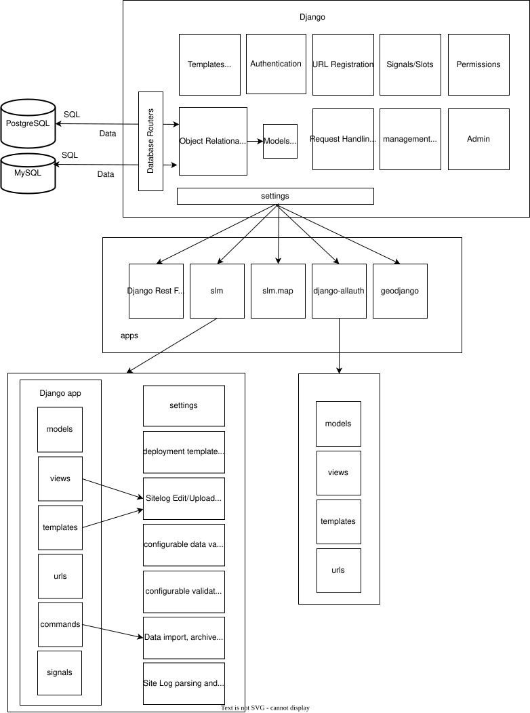

.. include:: ../refs.rst

.. _architecture:

============
Architecture
============

.. toctree::
   :maxdepth: 2
   :hidden:

   data_model
   extensions
   signals

SLM is built in Python_ using the Django_ website development framework.
:doc:`Django is well documented <django:index>`. A basic understanding of how it
works is imperative to understand how SLM is put together. In addition to the good
:doc:`intro tutorials <django:intro/tutorial01>`, it's helpful to
understand :doc:`how reusable Django apps work <django:intro/reusable-apps>`,
:doc:`how settings files work <django:topics/settings>` and
:doc:`how management commands work <django:howto/custom-management-commands>`.
:ref:`See below <django_resources>` for links to detailed learning and developer resources for
Django_.

At a high level, Django_ implements most of the common functionality required of modern relational
database-backed dynamic websites. It provides a pluggable request/response pipeline, encourages an
`MVC design pattern <https://en.wikipedia.org/wiki/Model%E2%80%93view%E2%80%93controller>`_,
provides an easy to work with
`Object Relational Mapping (ORM) <https://en.wikipedia.org/wiki/Object%E2%80%93relational_mapping>`_,
:doc:`manages database structure updates for you <django:topics/migrations>`,
and does a lot more to remove the drudgery from modern web development.

For experienced developers there are a few things to understand about working with a Django_ based
project:

    1. **You will not be writting a lot of SQL.** You can always drop back to SQL, but Django_ has
       a :doc:`built-in ORM <django:topics/db/queries>` that maps
       python classes called ``Models`` to relational database tables. These classes are easy to
       work with and allow Django_ to manage the database structural upkeep for you. If you make
       a change to one of your models, Django_ can generate code that will automatically update
       the database structure for you.

       For example a SQL query that gets all rows from the Site table where the name column begins
       with JPLM would look like this in SQL:

       .. code-block:: SQL

            SELECT * FROM slm_site WHERE name LIKE 'JPLM%';

       and look like this in Python_/Django_:

       .. code-block:: python

            from slm.models import Site

            Site.objects.filter(name__startswith='JPLM')

       The Django code returns an iterable of instantiated objects of type Site where each column
       in the Site table is a member attribute on the Site object.

    2. **Django bootstraps (i.e. configures itself) off of normal python files**. This is called
       the Django_ settings file and it contains define-like Python variables that control and
       configure aspects of the framework. To bootstrap any Django_ project you will need to point
       the framework at your settings file. This is typically done by setting the
       ``DJANGO_SETTINGS_MODULE`` environment variable. The
       :doc:`Django settings file contains plain old data <django:ref/settings>`
       that Django_ code and third party extensions use to build the data structures that
       participate in the request/response cycle during runtime, not limited to, but including:

        * :doc:`Database Configurations <django:ref/databases>`
        * :ref:`HTML Templates <django:template-engines>`
        * :ref:`Request/Response Middleware Stack <django:topics/http/middleware:activating middleware>`
        * :ref:`Globalization <django:settings-i18n>`
            * :doc:`Timezones <django:topics/i18n/timezones>`
            * :doc:`Translations <django:topics/i18n/translation>`
        * :doc:`URL Routing <django:topics/http/urls>`
        * :ref:`Authentication <django:ref/settings:auth>`
        * :ref:`Static Files <django:settings-staticfiles>`
        * :ref:`Uploaded Media <django:file-upload-settings>`
        * :setting:`Debugging mode <django:DEBUG>`
        * :setting:`Logging <django:LOGGING>`

    3. **Django uses a pluggable application system to provide extensibility and override.** This
       is the primary vehicle for separation of concerns and encapsulation in Django_ projects.
       Django_ apps bundle database structure, html templates, URL dispatch and views into
       reusable, separately installable components that can be layered on top of each other. The
       app stack is
       :setting:`set in settings <django:INSTALLED_APPS>`
       using the ``INSTALLED_APPS`` list. Apps that appear closer to the front of the list override
       behavior in apps that appear further down the list. For example, if an app defines an html
       template of the same name as an app further down the installed application list, it's
       template will be used instead.

       The SLM is implemented as a Django_ app. An extension app is bundled with the SLM and is
       optionally installable called ``slm.map``. This contains the mapbox map widget. It is
       intended that any desired overrides to SLM behavior can be implemented in separate
       Django_ apps and installed above the SLM on the app stack. By this mechanism you should
       be able to avoid forking the SLM if you need more custom behavior.

The below conceptual block diagram highlights some of the major components and responsibilities
of the SLM and where they reside.

|

.. _django_resources:

Django Resources
================

Django_ was first released in 2005 and much of the web's infrastructure is built on it. There are
many free and paid resources for learning more about Django_ and an
`enormous corpus of freely available third party extension applications <https://djangopackages.org/>`_.

    * :doc:`The Official Documentation <django:index>`

        Django's official documentation is the go-to reference. It also has a number of helpful
        tutorials.

    * `Django Packages <https://djangopackages.org>`_

        This website catalogs most of the third party extensions available for Django_.

    * `Awesome Django <https://github.com/wsvincent/awesome-django>`_

        A curated list of useful Django_ resources and third party packages.

    * `Django From First Principles <https://www.mostlypython.com/django-from-first-principles/>`_

        A series of posts by `Python Crash Course author Eric Matthes <https://ehmatthes.github.io/>`_
        laying out the basics of getting started with Django_.

    * `Django for Beginners <https://djangoforbeginners.com/>`_

        An excellent project-based book for learning Django_ development.
